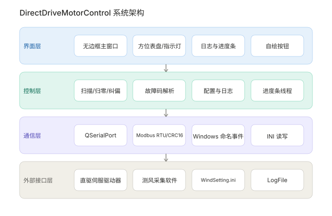
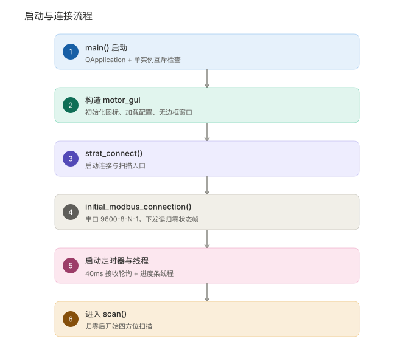
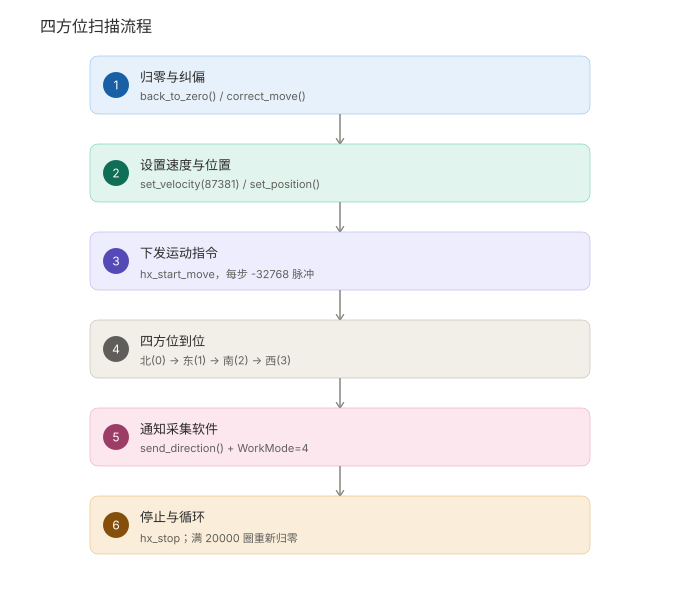
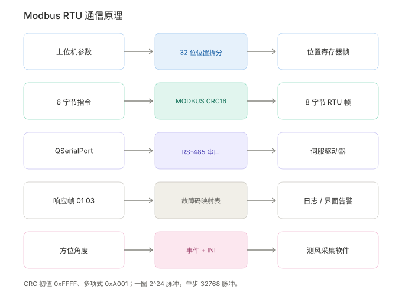

# 系统架构与关键流程

## 1. 系统架构

软件分为界面层、控制层、通信层与外部接口层四层。



| 层次 | 组成 | 职责 |
|------|------|------|
| 界面层 | `motor_gui.ui`、`QDial`、`QProgressBar`、`QTextBrowser`、自绘按钮 | 方位指示、扫描进度、日志显示与窗口交互 |
| 控制层 | `motor_gui` 主窗口、`thread_obj` 进度条线程 | 扫描状态机、归零纠偏、故障解析、配置与日志 |
| 通信层 | `QSerialPort`、`MODBUS_crc16()`、`add_CRC_code()`、Windows 事件 | Modbus RTU 组帧/校验、串口收发、联机通知 |
| 外部接口层 | 直驱伺服驱动器、`C:/WindSetting.ini`、测风采集软件、`D:/LogFile` | 执行机构、数据共享与持久化 |

**数据流**：INI 配置 → `load_setting()` → 控制层 → Modbus 帧 → 伺服驱动器 →
应答帧 → `parseFaultCode()`/`log_record()` → 界面；`send_direction()` → 共享 INI + 事件 → 采集软件。

## 2. 关键流程一：启动与连接



1. `main()` 创建 `QApplication`，`checkOneRunning()` 检查互斥量保证单实例；
2. 构造 `motor_gui`：初始化图标、加载配置、设置无边框标志、创建 `QSerialPort`；
3. 建立 40ms `status_timer2` → `get_return_signal()` 接收轮询；
4. `strat_connect()` → `initial_modbus_connection()` → 9600-8-N-1 打开串口；
5. 读 `01 03 60 41 00 01` 判断连接，成功后启动进度条线程并进入 `scan()`。

## 3. 关键流程二：四方位扫描



1. `scan()` 置 `running=true`，`back_to_zero()` 归零并 `correct_move()` 纠偏；
2. 写 `hx_disable` / `hx_mod_set` / `hx_enable`，`set_velocity(87381)` 设置速度；
3. `set_position(curr_pulse)` 下发位置，每次递减 32768 脉冲；
4. 写 `hx_start_move`，等待到位应答后按 `degree_change` 更新方位指示；
5. `send_direction(0/90/180/270)` 通知采集软件，进度条线程显示等待时间；
6. 写 `hx_stop` 结束本方位，`degree_change` 循环到下一方位；
7. 满 20000 圈重新归零，避免累计误差。

## 4. Modbus 通信原理



控制指令以 6 字节固定格式组织，经 `MODBUS_crc16()`（初值 0xFFFF、多项式 0xA001）
计算 2 字节校验后，由 `QSerialPort` 以 RTU 帧发出；
响应帧经 `get_return_signal()` 解析：若为故障查询响应（`at(1)==0x03`、`at(2)==0x02`），
用 `(at(3)<<8)|at(4)` 组合故障码并查表得到中文描述。

## 5. 时序关系

```text
main ──> checkOneRunning() ──> motor_gui() ──> strat_connect()
                                                  │
                              initial_modbus_connection()
                                                  │
                              status_timer2(40ms) 周期 get_return_signal()
                                                  │
                              progress thread ──bar_signal──> display_bar()
                                                  │
                              scan() ──> back_to_zero ──> [北→东→南→西]*
                                                  │
                              send_direction() ──> WindSetting.ini + 事件
```

- 串口接收由定时器驱动，进度条由独立 `QThread` 驱动，二者通过全局标志协同；
- 长等待使用 `long_sleep()`（Sleep(10) + `qApp->processEvents()`）避免界面冻结。
